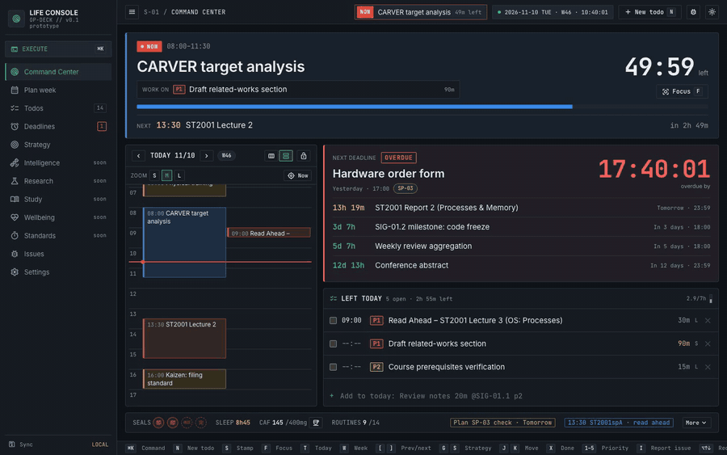
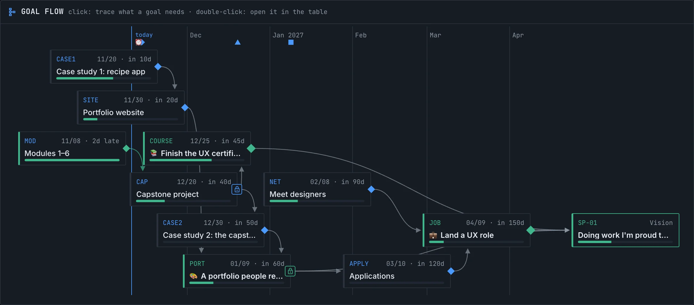
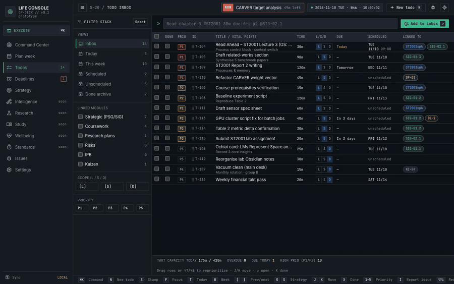
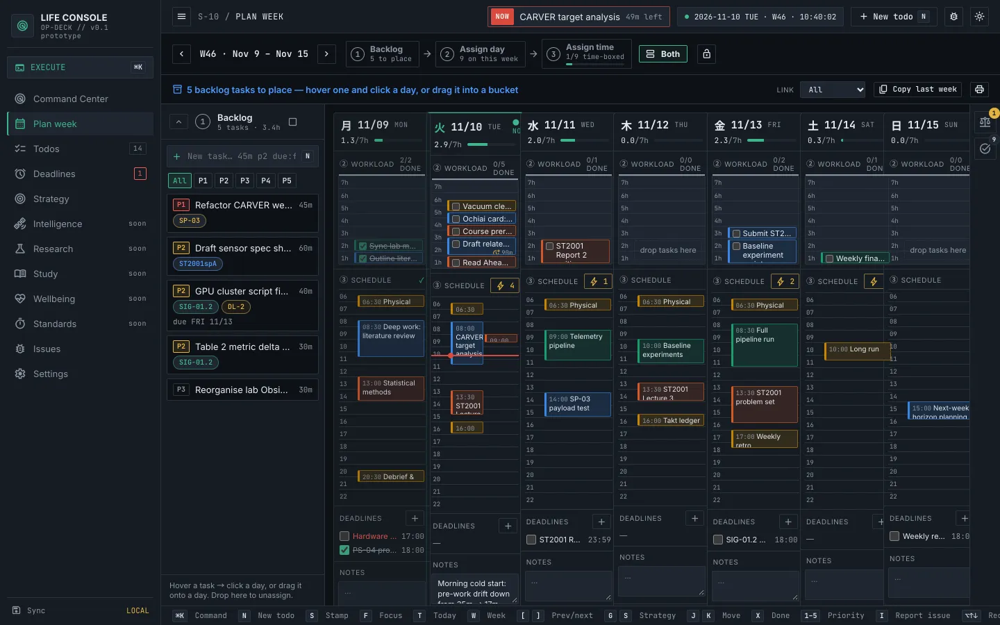
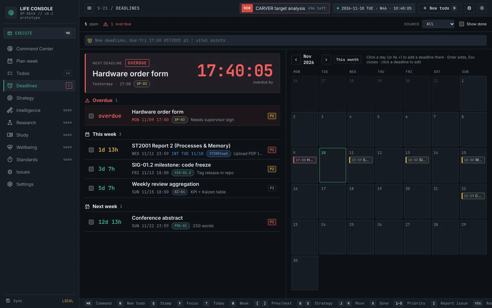
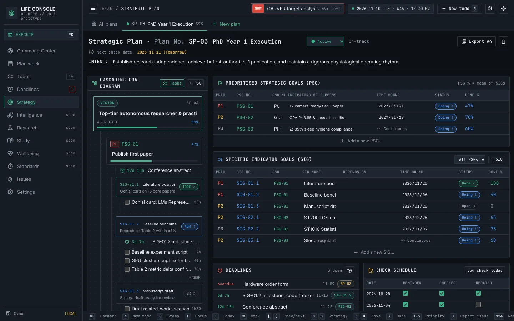
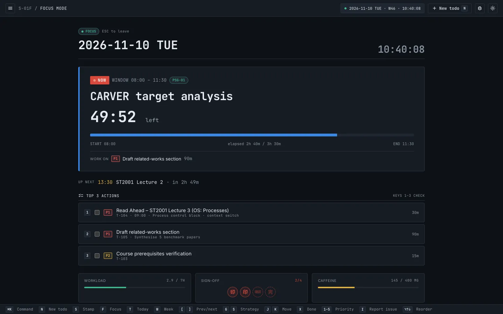

# Life Console

**Know what to do right now.** An open-source, keyboard-first planner for your week, your deadlines and your goals. Use it free at [life-console.dev](https://life-console.dev), or run it on your own server.

[Website](https://life-console.dev) · [Self-hosting](docs/SELF_HOSTING.md) · [User guide](docs/GUIDE.md) · [License: AGPL-3.0](LICENSE) · [★ Star on GitHub](https://github.com/TJ-coding/life-console) · [☕ Buy me a coffee](https://buymeacoffee.com/tjcoding)

<a href="https://life-console.dev/app?from=github"></a> <a href="https://buymeacoffee.com/tjcoding"></a>



Life Console started as a set of paper planning sheets: a week plan with a backlog, a 7-hour budget for each day and a timeline, a deadline list, and a strategic plan running from vision down to milestones. It joins those sheets into one console, so the answer to "what should I be doing now?" is always on screen.

## Features

- **The current block, counting down.** Today opens on the block you should be in, how long is left and the task to work on, beside the day's timeline and the next deadline. In free time it suggests the highest-priority task that fits before your next block.
- **Plan the week in three moves:** backlog → day → time. Each day has a 7-hour budget; **Auto time-box** fits tasks into free gaps by priority. A big task's estimate becomes a budget you spread over several days.
- **Deadlines as time left.** Every deadline is a ticking countdown, grouped by week, beside a month calendar, with optional personal target dates.
- **Tasks linked to goals.** Strategic plans run from vision to goals to milestones. Tag a task `@SIG-01.2` and it shows under that milestone.
- **One-line quick-add:** `Read chapter 3 #ST2001 30m due:fri p2 @SIG-02.1 [L]` sets the estimate, due date, priority, links and type. Subtasks go to any depth.
- **Keyboard first.** `⌘K` command palette, `F` focus mode, `W` week, `G D` deadlines, `J`/`K`, `X` done, `1`–`5` priority.
- **Pomodoro-aware planning**, push notifications with a **Mark done** action, dark and light themes.
- **Works on phones and offline.** Install it from the browser; it syncs across devices and merges edits made on two devices at once.



Each strategic plan is also drawn as a **goal flow**: milestones feed the goals that depend on them, laid out on a timeline and ending in the vision. Click a goal to trace everything it needs.



| | |
|---|---|
|  |  |
| **Plan week**: backlog, workload buckets, timelines | **Deadlines**: time left and a month calendar |
|  |  |
| **Strategic plan**: vision → goals → milestones | **Focus mode**: one block, three actions |

Every screen is described in the **[user guide](docs/GUIDE.md)**.

## Use it

**Hosted:** [open the app](https://life-console.dev/app?from=github) and sign in with Google. It's free, with no ads ([privacy policy](https://life-console.dev/privacy)).

**Self-hosted:** you need Docker with the compose plugin and about 300 MB of RAM.

```bash
git clone https://github.com/TJ-coding/life-console.git && cd life-console
cp .env.example .env    # set POSTGRES_PASSWORD
docker compose up -d    # PostgreSQL + app + daily backups on http://localhost:8080
```

The first account you create becomes the admin. To install it on phones and get notifications, put it behind HTTPS and set `APP_URL`. The **[self-hosting guide](docs/SELF_HOSTING.md)** covers HTTPS, sign-in options (email and password, Google, or both), backups, updates and the admin CLI.

You can move between the hosted service and your own server at any time: export your planner as JSON in Settings and import it on the other side.

## Develop

```bash
npm install
cp .env.example .env    # point DATABASE_URL at a Postgres
npm run dev:server      # API + push scheduler on :8787
npm run dev             # app on http://localhost:5173 (proxies /api to :8787)
npm test                # API tests (needs TEST_DATABASE_URL)
```

Without the server the app still runs: sync stays off and data lives in the browser.

Built with Vue 3 and Vite on the front end, and Node 22, PostgreSQL (Drizzle ORM) and Web Push on the server, in plain JavaScript. Before changing code, read **[CLAUDE.md](CLAUDE.md)**: the project map, data model, rules for changing the data shape, conventions and how to verify changes. **[docs/DESIGN.md](docs/DESIGN.md)** has the screen design rules, and **[docs/OPERATIONS.md](docs/OPERATIONS.md)** covers hosting, deploys, backups and troubleshooting.

Found a bug or have an idea? Press `I` on any screen in the app to report it about that screen, or open a GitHub issue.

## Support

Life Console is free and made by one developer. If it helps you, you can [buy me a coffee](https://buymeacoffee.com/tjcoding) to keep it running, or star the repo.

<a href="https://buymeacoffee.com/tjcoding"></a>

## License

Life Console is free software: you can redistribute it and/or modify it under the terms of the [GNU Affero General Public License v3.0](LICENSE) or (at your option) any later version. If you run a modified version as a network service, you must offer its users the corresponding source code.
