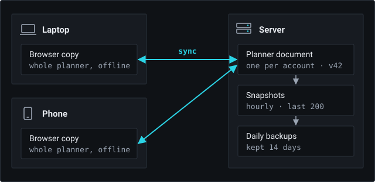
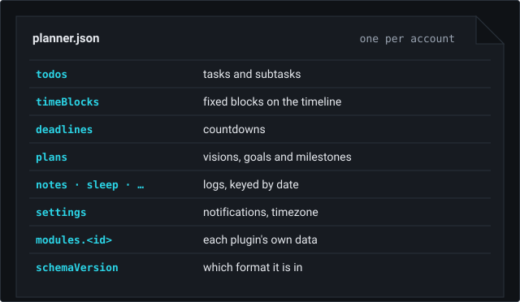
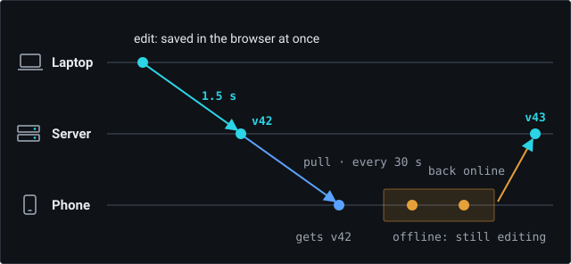
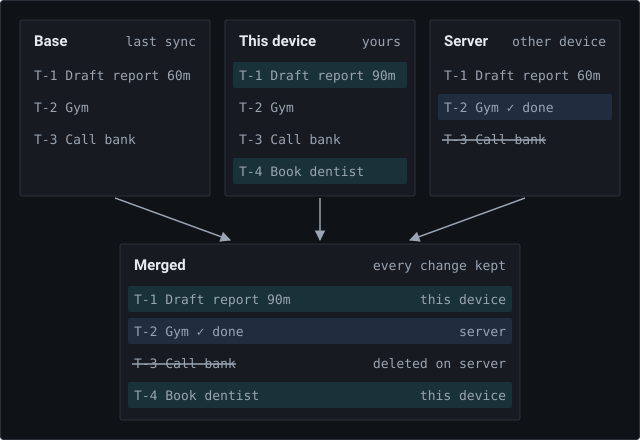
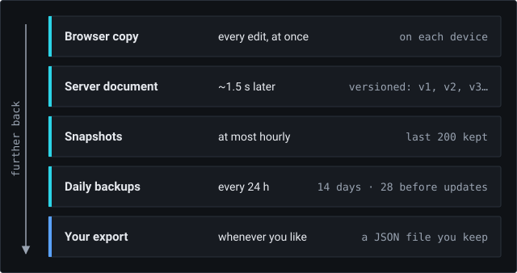
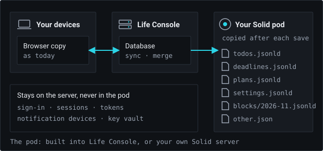

# How Life Console stores your data

Life Console keeps your whole planner as **one document**: a single JSON file per account. That document lives in two places: in your browser, where the app reads and writes it, and on the server, which keeps every device in step. This page explains how the two stay in sync, what happens when they disagree, and how you get your data back out.

## One planner, one document

Everything you put into the planner is in that one document: tasks, schedules, deadlines, goals and milestones, notes, routines, sleep and caffeine logs, and your settings. Plugins keep their data in the same document, each in its own section with its own version number.

On the server, the document is a single row in a PostgreSQL database, stored as `jsonb`, with a version number that goes up by one on every save. There's no table per kind of item, so the planner you export is exactly the planner the server holds.

## Your browser comes first

The app never waits for the server:

- **Every change is saved in your browser straight away.** A full copy of the planner sits in the browser's local storage, so the app opens instantly and works offline.
- **The change is sent to the server** about a second and a half after you stop editing, and again whenever you switch away from the tab.
- **Changes from your other devices are fetched** every 30 seconds while the app is open, when you come back to the tab, and when your connection returns. If nothing changed, the server answers in a few bytes.

Offline, the app shows *Offline: changes are kept and will sync*, and keeps working from the browser copy. The changes go up when you're back online.

## When two devices both changed something

Every save says which version it was based on. If another device saved in the meantime, the server refuses the save and sends back its newer copy. Your device then merges the two and tries again. It compares three copies:

1. **The base:** the last version this device synced.
2. **This device's copy.**
3. **The server's copy.**

Lists such as tasks, deadlines and goals merge item by item, so:

- **Changes made on only one device are always kept.** You can add tasks on your phone and edit others on your laptop at the same moment, and nothing is lost.
- **A deleted item stays deleted**, unless the other device edited it in the meantime. Then the edit wins and the item comes back.
- **The same field changed differently on both devices:** the edit from the device that's saving now wins.
- **Both devices created a new item with the same number** (both made `T-120`): both are kept, and one gets the next free number.

The first time you sign in on a browser that already holds a planner, nothing is merged automatically. The app asks which copy to keep.

## Old app versions can't overwrite new data

When an update changes how the planner is stored, the server upgrades the document. A save from an app that's still on the older format (a tab left open for days, say) is refused instead of overwriting the upgraded data, and that tab is asked to reload. Plugin data is protected in the same way, by the version number on each plugin's section.

## Snapshots and backups

There are two safety nets on the server, for mistakes and bugs:

- **Snapshots:** while your planner is changing, the server keeps a copy at most once an hour, and always before a save replaces the server's copy outright. It keeps up to the 200 most recent per account. The operator of the server can restore one (`npm run admin -- restore`), so if something goes wrong, ask.
- **Database backups:** a full backup every day, kept for 14 days. A backup taken before each update is kept for 28 days.

## What the server can and can't see

- **Your planner isn't end-to-end encrypted.** The server stores it in readable form so it can merge edits from different devices. It's protected by HTTPS on the way there and by a database that isn't reachable from the internet. If that matters to you, run your own server (below).
- **No passwords.** On life-console.dev you sign in with Google. Session tokens and the tokens for the API and the Mac app are stored only as one-way hashes, so a database copy can't be used to sign in.
- **Notifications** are encrypted to your device under the Web Push standard. The push service sees only delivery details.

The [privacy policy](https://life-console.dev/privacy) lists everything life-console.dev stores and for how long.

## Trying it without an account

If you start the app without signing in, the planner stays in that browser only and nothing is sent to the server. When you sign in later, that planner moves into your account. If the account already has a planner, the app asks which one to keep.

## Taking your data with you

- **Export:** Settings → Data → **Export JSON** downloads the whole document: everything you entered, in a format you can read or script against.
- **Import:** **Import JSON** in the same place loads an export, on any Life Console server.
- **Sign out:** signing out removes the planner copy from that browser. Your account still has it.
- **Delete:** Settings → Account → **Delete account** removes your account, planner, snapshots and notification devices from the live database straight away, and from backups once they expire.

## Coming next: your data in a Solid pod

[Solid](https://solidproject.org/) is an open standard, led by the web's inventor Tim Berners-Lee, for keeping your personal data in a **pod**: a data store you choose, which any app you approve can read and write. Life Console's next release puts your planner in one. It's built and being tested now; it isn't on life-console.dev yet.

- **Every save is copied to your pod**, a few seconds later, as a handful of standard JSON-LD files: tasks, deadlines, plans and settings, time blocks one file per month, and everything else in one more file. Each record keeps all its fields, so another Solid app can read what's in your planner, and the copy loads back exactly.
- **Where the pod runs is up to you:** by default it's built into Life Console, at `/pods/<your handle>/`; or point Life Console at your own Solid server or a Solid provider, and the planner is written there instead.
- **Moving is a copy.** *Copy my planner from a pod* loads it into any Life Console server, hosted or self-hosted.
- **What stays out of the pod:** your sign-in, sessions and access tokens, which devices get notifications, and the vault of connection keys. Any Solid app you approve can open a pod, so secrets don't belong there.

In this first version, everything above this section still works the same way: the database does the syncing, merging and snapshots, and the pod is a copy written after it. Later the pod becomes the main home of your planner, and the database keeps only what the service needs to run.

## Running it yourself

Life Console is open source (AGPL-3.0). A server you run yourself works in exactly the same way: one PostgreSQL database holds the documents, snapshots and daily backups, and you decide where it lives. See [Self-hosting](SELF_HOSTING.md) to set it up and [Backups and restore](SELF_HOSTING.md#6-backups-and-restore) to keep copies off the server.
