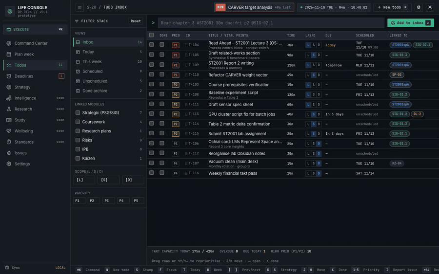

# Life Console user guide

Everything Life Console does, screen by screen. For a quick overview, see the [README](../README.md); to run your own server, see [SELF_HOSTING.md](SELF_HOSTING.md).

## Screens
| Screen | Route | Works |
|---|---|---|
| S-01 Command Center | `#/` | driver's console: NOW full width on top (next block as a one-line hint); below it the day's schedule beside the next deadline (title left, a big ticking time-remaining or overdue-by readout right, plus the next four) and **Left today**, which stretches to the bottom of the column; the page fills the window; the day's timeline (vertical by default with S/M/L zoom and Now, or the horizontal strip; remembered per device; drag todos onto it); **Left today** with priority, start time, a small workload meter (right end of its header) and one-click delete (Undo in the toast); one telemetry line (seals, sleep, caffeine, routines, due-now alerts). **More** (remembered) brings back the full briefing: 7-day deadlines, top PSGs, sign-off ledger, routines/sleep/caffeine/reviews/lectures tiles |
| S-11 Day view | `#/day/YYYY-MM-DD` | the Command Center for any date: ‹ › arrows or `[` `]` step a day, **Today** returns; non-today dates show a day summary instead of the live NOW card; click a day header in Plan week to open it |
| S-10 Plan week | `#/week` | the whole planning flow on one sheet: ① backlog panel → ② a 7-hour workload bucket per day → ③ that day's timeline directly below; one-click day buttons, Auto time-box, linked hover, balance and routines in a side rail; click the backlog header for **Backlog only** (deadlines & goal milestones beside the backlog); tasks can link to deadlines (`DL-n`) |
| S-20 Todo Inbox | `#/todos` | views / link / L-S-D / priority filters, smart quick-add parser, bulk schedule / priority / link / done, edit drawer. **Subtasks** (any depth): break a task down in its drawer (quick-add syntax, e.g. `Write intro 20m`); the task's estimate becomes a budget with a "left to assign" readout, subtasks inherit its links/priority and are what you schedule; the task is done when they all are. Shown nested in the inbox and the strategy tree, with a parent breadcrumb in the backlog and day lists |
| S-21 Deadlines | `#/deadlines` | the next deadline on top with a big ticking countdown; every row leads with time left (colour = urgency); list grouped Overdue / Today / This week / Next week / Later (+ Done) and, on wide screens, the month calendar beside it (phones toggle List / Month) (click a day, or its +, to add a deadline right in that cell); quick-add, source filter, edit/delete dialog; overdue badge in the sidebar |
| S-35 Strategy overview | `#/strategy` | goals at a glance: next milestone (nearest SIG time bound) as a big countdown with a "N goals behind" flag; every active plan's PSGs with their SIGs as rows (progress, criteria, linked deadline countdown, time bound; late SIGs red, the next SIG tagged NEXT; click opens the plan with that goal selected); plan cards (status, delete) below |
| S-30 Strategic Plan | `#/strategy/SP-03` | Vision → PSG → SIG tree with each goal's linked tasks under it (Tasks toggle, "+ task" per SIG), editable PSG/SIG tables (PSG % = mean of SIG %), time bounds as a date picker or ∞ Continuous with amber checks (not a date, SIG ends after its PSG, ends before a SIG it depends on), check schedule, events timetable, linked todos. **Goal flow** at the bottom: the plan as a dataflow of cards generated from SIG dependencies, on a calendar axis (each card's ◆ sits on its end date; today line, events and linked deadlines as markers). Arrows split and merge, SIG chains flow into their PSG and PSGs into the Vision; continuous/undated goals sit in an ∞ column; impossible orders drawn red; click a goal to trace what it needs (double-click opens it in the table). Drag a card sideways to move its time bound; drag a continuous one onto the axis to give it a date. **Focus:** selecting a goal lights up its SIGs, tasks, deadlines and dependencies (never its parents) and dims the rest. **Lock** a time bound (hover the Time bound cell or a flow card) to stop edits and dragging. A SIG's PSG can be changed in the SIG table (it is renumbered, links follow); the plan's deadlines show under their goals and in a Deadlines panel |
| S-95 Issues | `#/issues` | the to-fix list for the app itself: press `I` (or the bug button in the top bar) on any screen to report a bug, UX problem or idea about that screen; the screen, route and device are attached; filter by status/screen, change status, see how each was fixed. Agents read the list with `npm run issues` (see [docs/ISSUES.md](ISSUES.md)) |
| Other modules | `#/m/...` | Placeholder that lists the planned screens |

**Keyboard:** `F` focus mode · `⌘K` palette · `N` new todo · `T` today · `W` week · `G S` strategy · `G I` inbox · `G L` workload · `G D` deadlines · `J/K` move · `Enter` open · `X` done · `1–5` priority · `S` stamp · `[` `]` week · `I` report an issue · `G B` issues.

**Quick-add syntax:** `Read chapter 3 #ST2001 30m due:fri p2 @SIG-02.1 [L]`

## Deadlines
Add one from the Deadlines screen, the **Deadlines · 7d** panel on Today / the day view, or the **+** in any Plan week day's Deadlines section (defaults to that day). Syntax: `ST2001 Report 3 due:fri 17:00 #ST2001 p1 ! Upload PDF` (`due:` today / tomorrow / weekday / MM-DD / YYYY-MM-DD, defaulting to the day you're on; `HH:MM`, default 23:59; `p1`–`p5`; `#` or `@` sets the source; text after `!` becomes the vital points). Click any deadline to edit or delete it.

## Planning flow (mirrors the paper planner)
Everything happens on **Plan week** (`#/week`). Each day column is stacked like the paper template: **② Workload** (a 7-hour bucket) directly above **③ Schedule** (that day's timeline).
1. **Backlog** (left panel): capture new tasks in the box at the top (`N` focuses it; same quick syntax as the Inbox, e.g. `Write report 90m p1 due:fri @SP-03`). Hover a task and click a day button (each shows that day's free hours), or drag it into a day's bucket. Drop a task back here to unassign it.
2. **Assign day:** tasks stack in the bucket, sized by their estimate. Red overflow above the 7h line means too much; the Balance rail suggests moves.
3. **Assign time:** drag a block from the bucket straight down onto the timeline, or press ⚡ (per day) / **Auto time-box week** to fill free gaps between 08:00 and 21:00 in priority order.

The step bar shows progress (`4 to place → 12 on this week → 4/12 time-boxed`), and its buttons switch the layout to emphasise days, times or both. A guide line names the next thing to do. Hovering a task highlights it in the backlog, its bucket and its timeline at once. `/workload` and `G L` open the planner with the day-focused layout.

### Planning a task over days and times
Click a task's plan button (backlog cards and workload blocks; **Plan over days / times…** in the task drawer; double-click a merged workload card). The task's estimate is a budget:
1. **Days**: each day of the week has a − / + stepper (30 min steps, or **+ all** for the rest). The big **To plan** number goes down as you give days time, and each day shows its workload after the plan (`6.2/7h`, red only when over). **Spread evenly** and **Fill free time** fill the week in one click. Use ‹ › to plan into other weeks.
2. **Times within a day**: a day with time shows a strip of its schedule (grey = booked, blue = this task). **Add a time** takes a sitting (up to 1h) out of that day's amount and puts it in the next free gap; **Auto times** cuts the whole day amount into ≤ 1h sittings. Edit any start time or length; whatever has no time waits untimed in that day's bucket.

Anything not given to a day stays in the backlog. **Estimate − / +** changes the budget. `Enter` applies and `Esc` cancels; Apply can be undone from the toast. Opening it again on a planned task shows the current plan to edit (done parts are kept). Under the hood each sitting, each day's untimed rest and the backlog rest is an ordinary task part (`1/3`, `2/3`…, same title, links, priority, due date; existing ids are reused). The workload bucket shows all of a task's parts on one day as **one card** ("4h · 4 times"); the timeline shows each sitting as its own block. If dropping a task overfills a day, a message offers to plan it.

### Removing things from the schedule
- **Timeline ✕**: on a task it only clears the start time (the task stays on that day's list). On a fixed block it removes the block. On a phone the ✕ is always shown while the schedule is unlocked.
- **Tap a block** (works even when locked): fixed blocks open a dialog with **Remove from schedule**. Tasks open the drawer with **Remove from schedule** (clear the time), **Unschedule from <day>** (back to the backlog) and **Delete**.
- Every removal has **Undo** in the toast. The padlock (on by default on touch devices) only stops dragging, resizing and the ✕.

## What should I do right now?
- **NOW card** (top of Today): the block you should be in, with a live countdown and a progress bar, or how much free time you have. It also shows **what to do**: a todo linked to the current block, or in free time the highest-priority open todo that fits before the next block (**Start now** schedules it at the current time). The next block is shown with a countdown.
- **NOW pill** in the top bar on every screen, and in the **browser tab title**.
- **Focus mode** (`F`, `#/focus`): a full-screen view of the same information plus the top 3 actions (`1`–`3` to tick them off). `X` completes the todo you're currently on. `Esc` leaves.

## Timeline editing
- **Move:** drag any block (fixed or todo) along a timeline. In the Weekly Planner you can drop it on another day. It snaps to 15 min and keeps its duration.
- **Resize:** drag a block's end edge (the right edge on Today, the bottom edge in the week view) to change its end time. For a todo this changes its time estimate.
- **Schedule:** drag a todo from any list onto a timeline to give it a start time.

## Notes
- **Accounts:** with a server, everyone signs in (email + password); each account has its own planner. Settings → Account has sign out, change password and delete account. Signing out removes the planner copy from that browser. A new account starts with the demo planner (generated relative to the current week); Settings → Data resets, exports or imports it.
- Workload is the sum of the todo estimates scheduled on that day. Fixed time blocks are calendar items and don't count.
- Category colours (`--cat-*` in `styles.css`) come from the validated categorical palette. They're separate from the status colours (green = done, amber = warning, red = overdue).

## Moving several schedule items at once
- **Select:** Shift-, ⌘- or Ctrl-click blocks on any schedule (long-press on phones). While a selection is open, plain clicks/taps add or remove blocks. Esc clears it, and so does changing screen.
- **Move:** drag any selected block and they all move by the same amount (to another day too), or use ↑/↓ (15 min, Shift = 1 h) and ←/→ (a day). **Delete** takes them off the schedule (tasks stay on their day). The bar at the bottom has the same actions, and every action has one Undo.

## Pomodoro planning
- **Settings → Pomodoro** sets the rhythm (default 25m work, 5m short break, 15m long break after 4) and turns it on or off for all devices.
- While it's on, **Plan this task** moves estimates and day amounts in whole pomodoros, and **Auto times** walks the day's free gaps, filling each with as many whole pomodoros as fit (up to one set) with a long break after each sitting. Auto schedule and dragging a task onto the timeline also lay it out as pomodoros.
- A pomodoro sitting's block spans its breaks (50m of work = 09:00–09:55), drawn as dashed lines inside the block. Sittings keep their layout if the rhythm is turned off later.

## Phone app, sync and notifications
- **Install** (needs HTTPS): on iPhone use Safari → Share → *Add to Home Screen*; on Android use Chrome → *Install app*. Then go to Settings → Notifications → *Turn on for this device*. iOS needs 16.4+ and only delivers push to Home Screen apps.
- **Sync:** each account's planner is one document on the server (`/api/state`, versioned, snapshotted hourly). Devices push edits after about 1.5s and pull every 30s, on focus and when back online. Conflicts are three-way merged per record and field (`src/merge.js`); only clashes on the same field go to the newest edit, and the server keeps backups of overwritten versions. A device with its own data asks once whether to use the server's copy or its own.
- **Notifications** (server scheduler, `server/schedule.mjs`, in the timezone of the device you last used):
  - **Blocks and tasks:** N min before each block or timed task starts, plus *Time's up* when a timed task ends, with a **Mark done** action.
  - **Deadlines:** 1 day and 1 hour before, and at the due time.
  - **Daily:** a morning briefing, and an evening sign-off reminder.
  - **Wellbeing:** a caffeine cutoff warning and a wind-down reminder.
  - **Pomodoro switches:** in a pomodoro sitting, *Break · 5 min* when each pomodoro ends and *Back to work* when the break is over.

  Each kind can be toggled, and its times set, in Settings.
- **No sound or vibration?** The phone decides that, not the app, and Android often files a new site's notifications as *Silent*. Long-press a Life Console notification and choose *Alerting*, or go to Android Settings → Notifications → App notifications → Life Console (or Chrome) → the site's category → turn on Sound, Vibration and Pop on screen. Also check the site is *Allowed* in Chrome → Site settings → Notifications, the phone isn't on Mute/Do Not Disturb, and battery use is *Unrestricted*. On iPhone: Settings → Notifications → Life Console → Sounds and Banners on. The same steps are in Settings → Notifications → *Test arrives silently, or not at all?*
- **Server** (`server/`): plain Node `http`, PostgreSQL via Drizzle ORM, and `web-push`. Accounts, planners, snapshots, push devices, VAPID keys and the issue log are all in the database.
