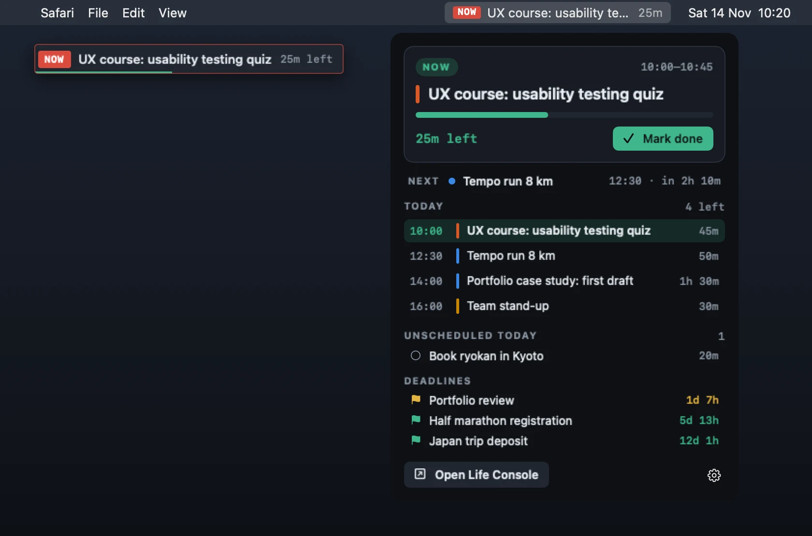

# Life Console Now: the Mac menu-bar app

What you should be doing right now, at the top of your screen: the current block and the time left, or what's next.
Click it for today's timeline, unscheduled todos and deadlines. An optional pill floats in the corner, even over
full-screen apps. Features and how to use it: [docs/GUIDE.md → Mac menu-bar app](../docs/GUIDE.md#mac-menu-bar-app-life-console-now).



## Install

- **Download:** `https://life-console.dev/download/mac` (any Life Console server has `/download/mac`; it redirects to
  the newest release here on GitHub). Open the `.dmg`, drag the app to Applications.
- **First launch:** the app is signed ad hoc but not notarised (that needs a paid Apple Developer ID), so macOS asks
  once: right-click → *Open*; on macOS 15, System Settings → Privacy & Security → *Open Anyway*.
- **Or from Terminal**, with no warning (files `curl` downloads aren't quarantined):
  ```sh
  curl -fsSL https://life-console.dev/download/mac.zip -o /tmp/lcn.zip && ditto -xk /tmp/lcn.zip /Applications && open "/Applications/Life Console Now.app"
  ```
- **Connect:** in Life Console, Settings → *Mac menu-bar app* → *Connect Mac app*.

## How it works

- `main.swift` is the whole app (AppKit + SwiftUI, no dependencies). It reads `GET /api/state` with an API token
  every minute, caches it for offline use, and recomputes "now" every few seconds. `compute()` is a port of
  `src/now.js` (`useNow`) and `server/pomodoro.mjs`, and the deadline countdowns follow `src/glance.js`: **if you
  change those, port the change here.** The headline (`Now.bar`) shows the next scheduled block between blocks.
- **Connecting:** Settings → *Connect Mac app* calls `POST /api/auth/tokens {name: "Mac app"}` (browser sessions
  only; a second call replaces the token) and opens `lifeconsole-now://connect?server=…&token=lct_…`. The app asks
  the person to confirm, then drops the previous account's cached planner.
- **Updates:** at launch and every 6 hours the app asks its server `GET /api/mac/latest`
  (`server/macapp.mjs` reads this repo's GitHub releases tagged `mac-vX.Y.Z` at most hourly). A newer version shows
  *Update available* in the panel and one macOS notification. *Install* downloads `LifeConsoleNow.zip`, checks its
  SHA-256 (GitHub's asset digest), checks the unpacked bundle's ID and version, then a small shell script waits for
  the app to quit, swaps the bundle in place, clears quarantine and relaunches it.

## Build

Needs only Apple's Command Line Tools (`xcode-select --install`), macOS 13+:

```sh
mac/build.sh            # version from mac/VERSION; or: mac/build.sh 1.2.3
open "mac/build/Life Console Now.app"
```

It writes `mac/build/Life Console Now.app` (universal: Apple silicon + Intel), `LifeConsoleNow.zip` and
`LifeConsoleNow.dmg`. The icon comes from `icon.jpg` (`mkicon.swift` makes the `.icns`).
`BUNDLE_ID=dev.life-console.now.test mac/build.sh 0.9.0` builds a copy with its own settings, for testing updates
end to end without touching your real install (`LCNOW_TEST_AUTOINSTALL=1` makes such a copy install an update it
finds without a click).

## Release

1. Bump `mac/VERSION`, merge to `main`.
2. Tag that commit `mac-vX.Y.Z` and push the tag:
   ```sh
   git tag mac-v1.0.1 origin/main && git push origin mac-v1.0.1
   ```
   `.github/workflows/mac-release.yml` builds it on a Mac runner and publishes the release (not marked *latest*,
   which stays the server's). Within the hour every server's `/download/mac` and `/api/mac/latest` serve it, and
   installed apps offer the update.
